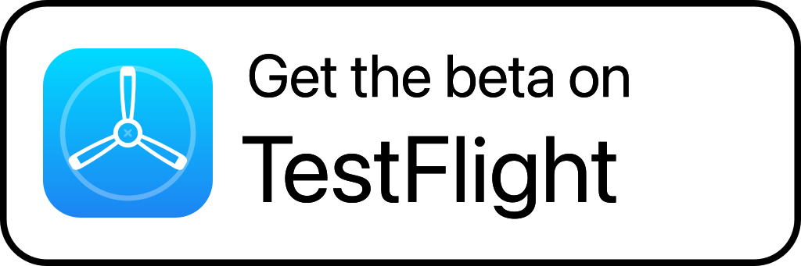

# Enchron

[简体中文](README.md) | [English](README.en.md) | 日本語 | [한국어](README.ko.md) | [Русский](README.ru.md) | [Français](README.fr.md) | [Deutsch](README.de.md)

[](https://github.com/1873663116/Enchron/actions/workflows/verification.yml) [](LICENSE)

Enchron は Apple Vision Pro 向けのメディアプレーヤーです。ウィンドウやイマーシブ空間で動画を再生でき、ローカルファイル、SMB、WebDAV、Emby のライブラリに対応しています。

## ステータス

Enchron は TestFlight で一般公開ベータテストを実施しています。Apple Vision Pro から下のリンクを使って参加できます。機能や互換性は変更される場合があります。

<a href="https://testflight.apple.com/join/F1xpZq6b">
  
</a>

## 機能

- ウィンドウ、ドック画面、イマーシブ環境で動画を再生します。
- ローカルのメディアを閲覧するか、SMB、WebDAV、Emby サーバーに接続します。
- 再生を操作し、字幕や音声トラックを選択できます。
- AVFoundation によるハードウェアアクセラレーション付きのデコードと描画を使用します。HDR10、HLG、Dolby Vision の再生可否はデバイスとメディア形式によって異なります。
- FFmpeg で一般的なメディアコンテナを読み込みます。H.264、HEVC、AV1 などのコーデックの再生可否はデバイスによって異なります。Apple Vision Pro（M5）は AV1 に対応しています。

## ビルド

このプロジェクトには Xcode 27.0 と visionOS SDK が必要です。クローン後、リポジトリのルートで次のコマンドを実行し、`Packages/PlaybackCore` が必要とする Git 管理外のバイナリ依存関係を用意してください。

```sh
Scripts/provision_vendored_ffmpeg.sh
Scripts/provision_vendored_bluray.sh
```

Blu-ray サンプルの構造は `Scripts/build/verify_bluray_corpus.py` が独立した MPLS パーサーと照合します。Blu-ray 専用の受け入れデータとシミュレーター検証ツールは `Scripts/verification/` にあります。ビルドと検証の入口は `Scripts/` と `Regression/` にあります。モジュールの所有範囲は [`ARCHITECTURE.md`](ARCHITECTURE.md)、プロジェクト制約は [`AGENTS.md`](AGENTS.md)、テスト手順は [`Regression/README.md`](Regression/README.md) を参照してください。

## プライバシーとネットワーク

Enchron はメディアサービスを運営せず、メディア、再生履歴、リモート認証情報を開発者に送信しません。アプリはユーザーが設定したサーバーに直接接続し、リモート認証情報をデバイスの Keychain に保存します。詳しくは [`PRIVACY.md`](PRIVACY.md) を参照してください。

TLS を設定していないセルフホストサーバーに接続するため、アプリは平文 HTTP を許可します。公開アドレスに接続する前に、認証情報が暗号化されずに送信される可能性を警告し、確認を求めます。HTTPS または暗号化されたプライベートネットワークを利用できます。

## ライセンスとサードパーティ製ソフトウェア

Enchron は GNU General Public License v3.0 の下で公開されています。ライセンス本文は [`LICENSE`](LICENSE)、サードパーティ製ソフトウェアとライセンスは [`NOTICE`](NOTICE) を参照してください。アプリの「設定」にも関連するライセンス情報があります。

## 外部からの貢献

現在、外部からの貢献は受け付けていません。このリポジトリはソースの閲覧、再現可能なビルド、ライセンス遵守のために公開しています。CI、署名、リリース用の基盤は外部のコントリビューターには公開されていません。
